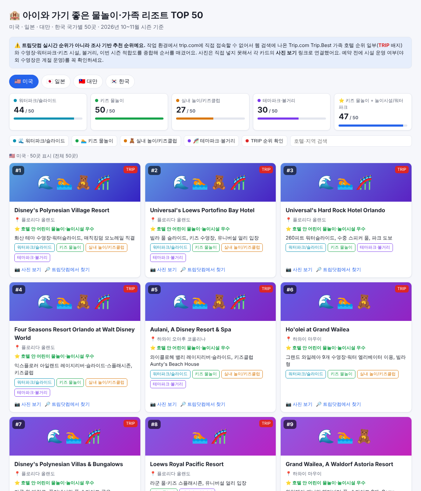

  <h1>Built with AI Studio</h2>

  
The fastest path from prompt to production with Gemini.

  <a href="https://aistudio.google.com/apps">Start building</a>

## 🏨 아이와 가기 좋은 물놀이·가족 리조트 TOP 50

[`family-resort-top50/index.html`](family-resort-top50/index.html) — 미국·일본·대만·한국 국가별 50곳씩 (2026년 10~11월 시즌 기준).
브라우저에서 열면 국가 탭과 시설 필터(워터파크·키즈 물놀이·실내 놀이/키즈클럽·테마파크)를 쓸 수 있어요.

> 트립닷컴 실시간 순위가 아니라, 웹 검색으로 확인한 Trip.com 가족 호텔 순위 일부와 시설·볼거리·시즌 적합도를 종합한 추천 순위예요. 예약 전에 시설 운영 여부를 꼭 확인하세요.

